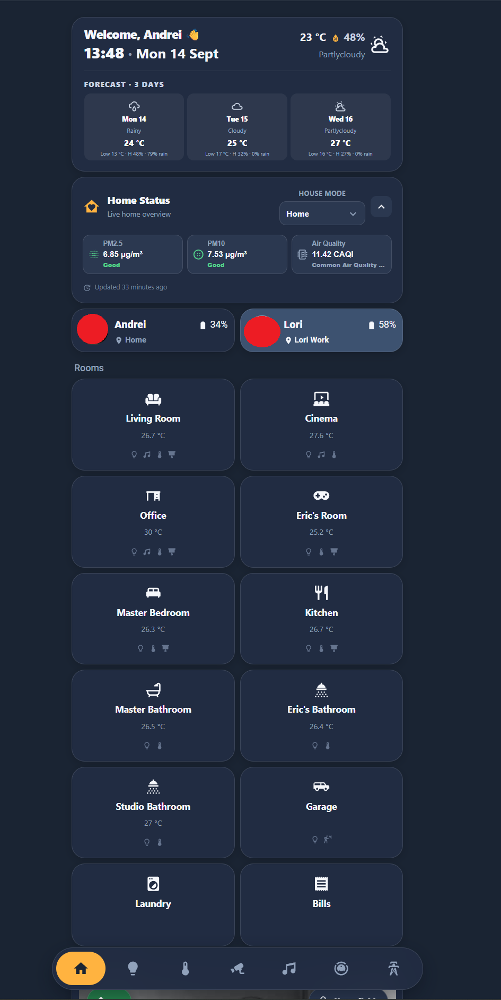
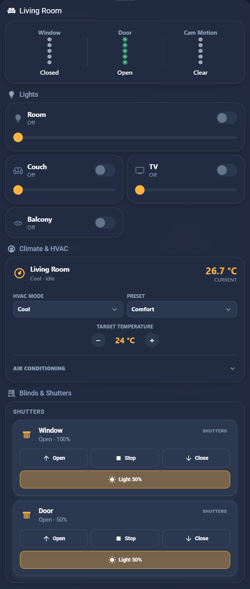
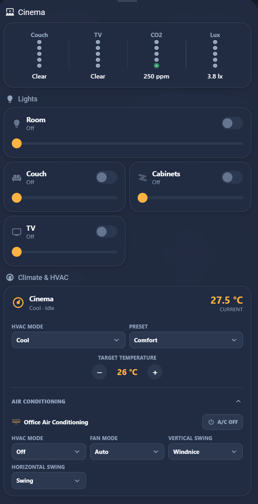
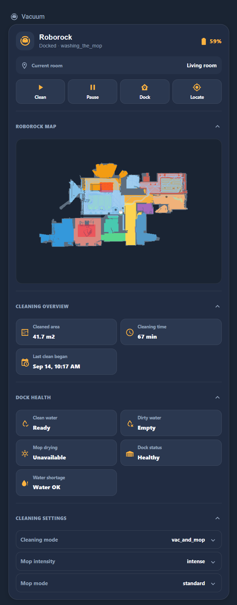
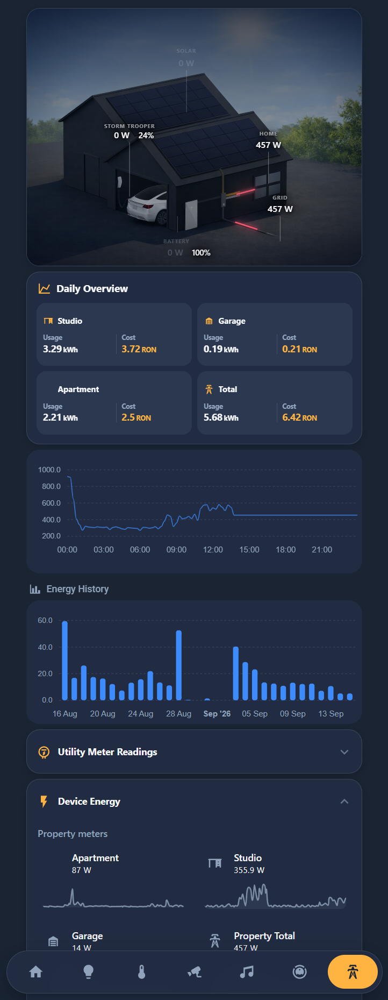

# Hollow Cards

[](https://www.hacs.xyz/)
[](https://github.com/MrHollowX/hollow-cards/actions/workflows/validate.yml)

Hollow Cards 1.1.0 is a HACS Dashboard plugin containing 17 standalone
JavaScript custom cards for Home Assistant. The cards use the stable
`custom:hollow-*` element names and are designed to be loaded as one module
resource.

This is a frontend card repository, not a Python `custom_components` integration:
there is no config flow, `manifest.json`, backend, or stored Home Assistant
state. The cards follow the Home Assistant Lovelace custom-card lifecycle and
use the authenticated frontend `hass` object for state and service calls.

## Install with HACS

1. Open HACS → Frontend.
2. Search for **Hollow Cards**. If it is not in the default catalog yet, add
   `MrHollowX/hollow-cards` as a custom repository with the **Dashboard** type.
3. Install the repository and add this single module resource if HACS does not
   add it automatically:

   ```yaml
   resources:
     - url: /hacsfiles/hollow-cards/hollow-cards.js
       type: module
   ```

The canonical entry point is `hollow-cards.js`; it imports the complete card
set from the HACS `dist/` payload. Remove duplicate legacy `/local/hollow-cards/`
resources or older `hollow-cards-set` resource URLs when migrating to HACS.

The live Home Assistant resource contract is documented in
[`hollow-cards/README.md`](hollow-cards/README.md), including the retained
inline-resource exception for `hollow-cover-card`.

## Cards included

Header, status, person, room tile, light, climate, cover, vacuum, door security,
entity status, energy overview, switch, group, floating menu, appliance,
camera grid, and standing desk cards are included. Each card is independently usable and exposes
its own configuration contract in the detailed card documentation.

## Screenshots

These screenshots show Hollow Cards running in a dark Home Assistant dashboard.
The entity names, readings, and states are representative of one installation and
will update with live Home Assistant data.

### Home overview



### Room controls





### Dedicated cards





## Release 1.1.0

Release 1.1.0 adds the standing desk card and keeps the source and `dist/` payload synchronized. See [`CHANGELOG.md`](CHANGELOG.md) for the release notes.

## Development and verification

After changing a source card, synchronize the HACS payload and run the tests:

```powershell
powershell -File scripts/sync-hacs-dist.ps1
node --test tests/*.test.cjs
```

The GitHub Actions workflow runs the Node.js checks and HACS validation with the
`plugin` category. HACS installs the JavaScript files from `dist/`; it does not
run the local test suite or deploy files to a Home Assistant host.

## Repository contents

- [`hollow-cards/`](hollow-cards/) — source cards and their HA resource/configuration contracts.
- [`dist/`](dist/) — mirrored HACS payload and the canonical `hollow-cards.js` entry point.
- [`tests/`](tests/) — Node.js invariant and packaging tests.
- [`CHANGELOG.md`](CHANGELOG.md) — release history.
- [`ai-overview.md`](ai-overview.md) — architecture and onboarding notes.
- [`ai-skill/SKILL.md`](ai-skill/SKILL.md) — shared contribution and HA workflow guidance.
